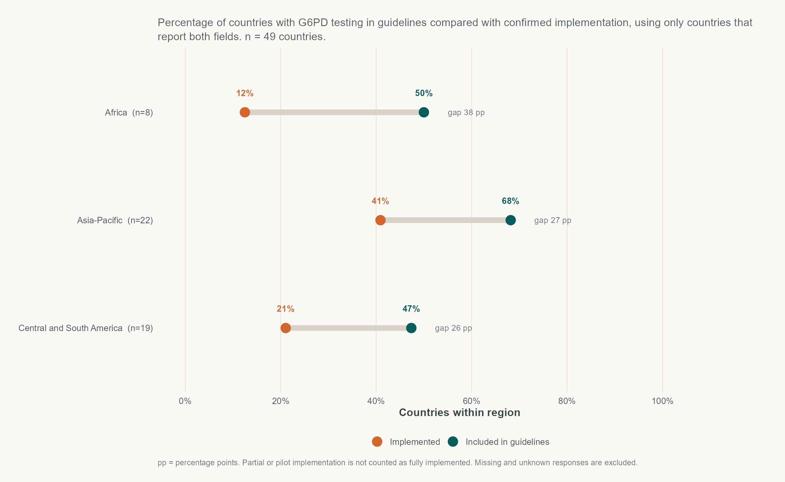
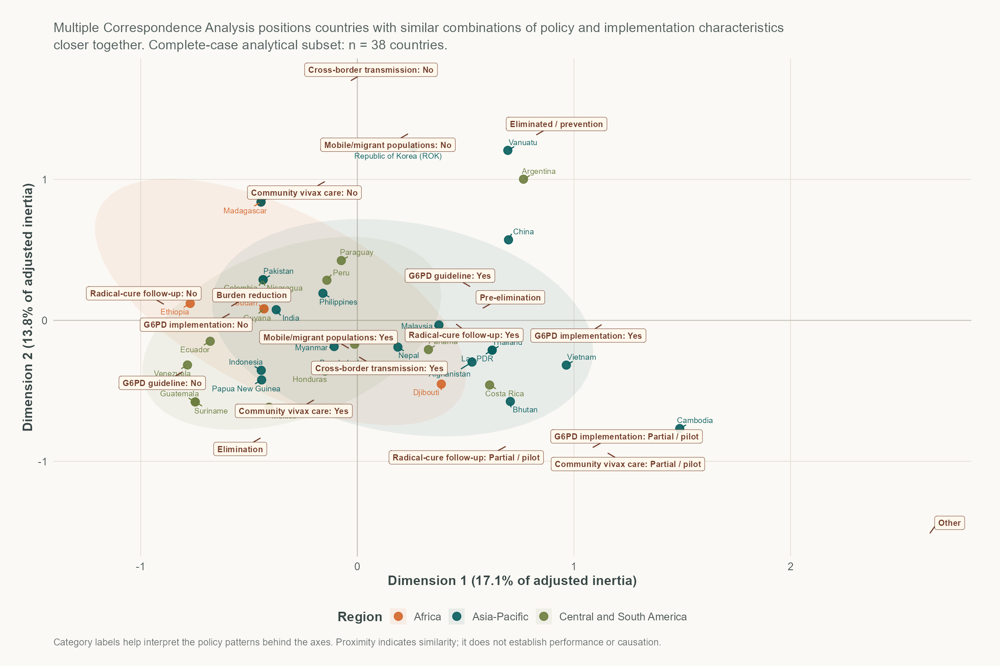

```{r}
#| label: setup
#| include: false

suppressPackageStartupMessages({
  library(readr)
  library(dplyr)
  library(jsonlite)
  library(crosstalk)
  library(DT)
  library(htmltools)
})

source("R/explore_helpers.R")

char <- load_characteristic_data() |>
  repository_rows()

char <- char |>
  mutate(
    first_line = collapse_first_line(`Pv 1st line treatment`),
    `2023 Case Numbers` = suppressWarnings(as.numeric(`2023 Case Numbers`)),
    vivax_share = suppressWarnings(readr::parse_number(
      `Proportion of P. vivax cases (2023) (%)`
    ))
  )

table_cols <- c(
  "Country", "Region", "WHO Region", "Vivax endemicity",
  "2023 Case Numbers",
  "Proportion of P. vivax cases (2023) (%)",
  "Pv 1st line treatment",
  "Pv 2nd line treatment",
  "Guidelines G6PD testing  (Y/N)",
  "Implementation: G6PD testing  (Y/N)",
  "Type of G6PD testing",
  "Program Phase",
  "Cross-border transmission",
  "Mobile Migrant Populations",
  "Economic status"
)

explore_payload <- explore_chart_payload(char)

shared <- SharedData$new(char, key = ~Country, group = "explore")
char_table <- char |>
  select(any_of(table_cols)) |>
  rename(
    `Vivax share of malaria cases (2023) (%)` = `Proportion of P. vivax cases (2023) (%)`,
    `First-line schizontocidal treatment` = `Pv 1st line treatment`,
    `Second-line schizontocidal treatment` = `Pv 2nd line treatment`
  )
shared_table <- SharedData$new(char_table, key = ~Country, group = "explore")
```

```{r}
#| label: explore-data
#| echo: false
#| results: asis

cat(as.character(htmltools::tags$script(
  id = "explore-data",
  type = "application/json",
  HTML(jsonlite::toJSON(explore_payload, auto_unbox = TRUE, dataframe = "rows", null = "null"))
)))
```

## Filter the data

Choose the characteristics you need. Selections apply to the **interactive charts and full data table**. The static analytical charts further down use a fixed dataset and are labelled separately.

```{r}
#| label: filters
#| echo: false

tagList(
  tags$details(
    class = "explore-filter-panel",
    open = NA,
    tags$summary(
      tags$span(class = "explore-filter-panel__title", "Choose filters"),
      tags$span(class = "explore-filter-panel__hint", "Open or close the filter panel")
    ),
    tags$div(
      class = "explore-filters",
      bscols(
        filter_select("region", "Region", shared, ~Region, multiple = TRUE),
        filter_select("who_region", "WHO region", shared, ~`WHO Region`, multiple = TRUE),
        filter_select("endemicity", "Vivax endemicity", shared, ~`Vivax endemicity`, multiple = TRUE),
        filter_select("recent_reporting", "Reporting vivax cases (last 5 years)", shared, ~`Reporting vivax cases (<5 years)`, multiple = TRUE),
        filter_select("program_phase", "Programme phase", shared, ~`Program Phase`, multiple = TRUE),
        filter_select("first_line", "First-line schizontocidal treatment", shared, ~`Pv 1st line treatment`, multiple = TRUE),
        filter_select("second_line", "Second-line schizontocidal treatment", shared, ~`Pv 2nd line treatment`, multiple = TRUE),
        filter_select("g6pd_guidelines", "G6PD testing in guidelines", shared, ~`Guidelines G6PD testing  (Y/N)`, multiple = TRUE),
        filter_select("g6pd_implementation", "G6PD testing implemented", shared, ~`Implementation: G6PD testing  (Y/N)`, multiple = TRUE),
        filter_select("community_malaria", "Community malaria care", shared, ~`Community malaria care`, multiple = TRUE),
        filter_select("community_vivax", "Community vivax care", shared, ~`Community vivax care`, multiple = TRUE),
        filter_select("radical_follow_up", "Follow-up of radical cure", shared, ~`Follow-up of radical cure`, multiple = TRUE),
        filter_select("community_follow_up", "Community follow-up of radical cure", shared, ~`Community follow-up of radical cure`, multiple = TRUE),
        filter_select("cross_border", "Cross-border transmission", shared, ~`Cross-border transmission`, multiple = TRUE),
        filter_select("mobile_migrant", "Mobile / migrant populations", shared, ~`Mobile Migrant Populations`, multiple = TRUE),
        filter_slider("vivax_share", "Vivax share of malaria cases (%)", shared, ~vivax_share),
        widths = rep(4, 16),
        device = "sm"
      )
    )
  )
)
```

## At a glance

::: {.explore-chart}
<div id="chart-cases" class="explore-chart__plot vivax-chart__plot--cases"></div>
<p class="explore-chart__caption">Top 15 countries by reported *P. vivax* case numbers in 2023 (updates with filters above).</p>
:::

## G6PD testing: policy vs. implementation

::: {.explore-chart}
<div id="chart-g6pd" class="explore-chart__plot vivax-chart__plot--g6pd"></div>
:::

The gap between **policy** and **implementation** is one of the most actionable findings in the repository — and the gap is widest in countries that have only recently adopted G6PD testing into their guidelines.

## First-line schizontocidal *P. vivax* treatment by region

::: {.explore-chart}
<div id="chart-heatmap" class="explore-chart__plot vivax-chart__plot--heatmap"></div>
:::

## How large is the G6PD policy-to-practice gap?

::: {.explore-static-chart}
<div class="explore-static-chart__status">Static analysis · Filters above do not affect this chart.</div>

{.explore-static-chart__image}
:::

## Which countries have similar policy profiles?

::: {.explore-static-chart}
<div class="explore-static-chart__status">Static analysis · Filters above do not affect this chart.</div>

{.explore-static-chart__image}
:::

## Full data table

The table below uses the same filters as the interactive charts at the top of this page. The two static analytical charts above are intentionally unaffected by those filters. To download the complete dataset (all columns), see [Data & downloads](data.qmd).

```{r}
#| label: table

datatable(
  shared_table,
  filter = "none",
  selection = "none",
  class = "display compact stripe",
  rownames = FALSE,
  options = list(
    dom = "frtip",
    pageLength = 25,
    lengthMenu = list(c(25, 50, 100, -1), c("25", "50", "100", "All")),
    scrollX = TRUE
  )
)
```

::: {.callout-edit}
Spot an inaccuracy or have a more recent guideline? Use the [contribute form](contribute.qmd) — submissions sync directly to the Google Sheet that this site reads from.
:::
